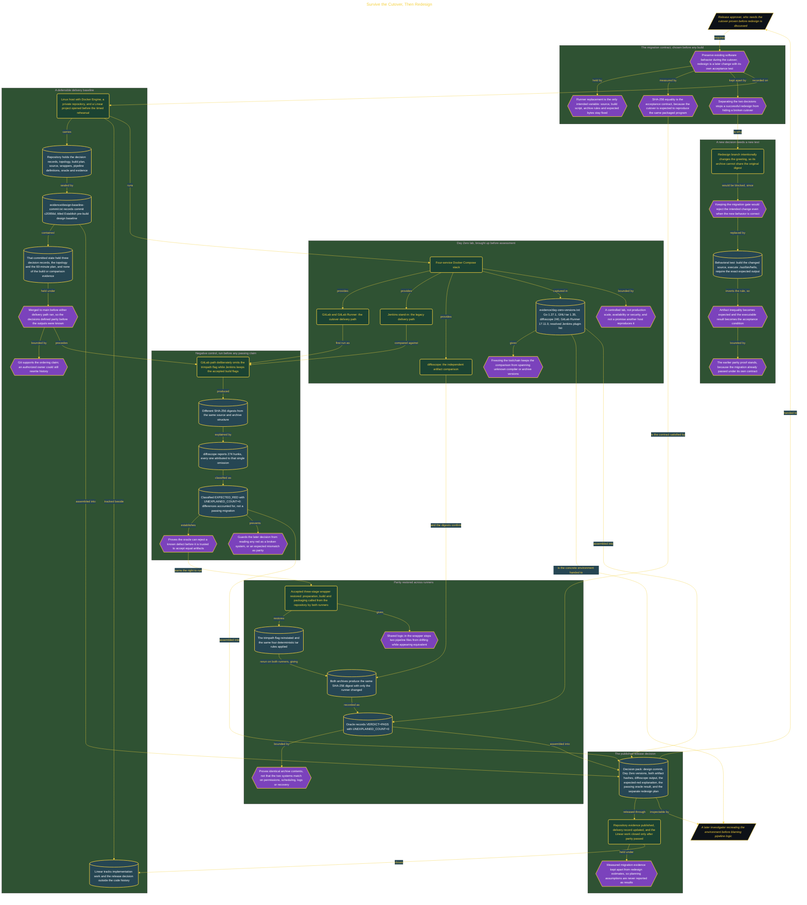

# Survive the Cutover, Then Redesign

> Inside the [Government Systems Engineering](../../README.md) portfolio · *Cloud systems engineered for federal-grade security and compliance.*

## Overview

I built this delivery rehearsal around one boundary: preserve the existing software behavior during the CI/CD cutover before redesigning the product. The migration moved execution from a Jenkins stand-in to GitLab CI while keeping the source, build script, archive rules, and expected artifact bytes unchanged. This made runner replacement the only intended variable.

I used a wrapper-first strategy so both runners called the same accepted three-stage process instead of implementing separate build logic. SHA-256 equality served as the migration contract because the cutover was expected to reproduce the same packaged program. I treated redesign as a later change with its own acceptance test because intentional product behavior would invalidate byte equality. Separating these decisions let me distinguish migration defects from approved product changes and prevented a successful redesign from hiding a broken cutover.

The architecture is built across **7 phases**, anchored by **Choosing a Wrapper-First Cutover Strategy** on the input side and **Demonstrating Why Redesign Requires a New Acceptance Test** at the end. Each phase is listed in the Implementation section below.

## Architecture

The diagram shows the topology and data flow of the system as built. The full architectural narrative, with screenshots and prose, lives in [`documents/byte-parity-cutover-rehearsal.md`](./documents/byte-parity-cutover-rehearsal.md).

## Implementation

This system is built across **7 phases**:

1. **Choosing a Wrapper-First Cutover Strategy**
2. **Establishing a Defensible Delivery Baseline**
3. **Launching a Reproducible Day-Zero Lab**
4. **Proving the Oracle Can Detect a Known Difference**
5. **Restoring Artifact Parity Across Runners**
6. **Publishing the Evidence-First Release Decision**
7. **Demonstrating Why Redesign Requires a New Acceptance Test**

For the full walkthrough with screenshots and step-by-step content, see [`documents/byte-parity-cutover-rehearsal.md`](./documents/byte-parity-cutover-rehearsal.md).

## Validation

Each build phase below is documented in [`documents/byte-parity-cutover-rehearsal.md`](./documents/byte-parity-cutover-rehearsal.md), with screenshots, configuration, and notes as captured during the build:

- ✅ Choosing a Wrapper-First Cutover Strategy
- ✅ Establishing a Defensible Delivery Baseline
- ✅ Launching a Reproducible Day-Zero Lab
- ✅ Proving the Oracle Can Detect a Known Difference
- ✅ Restoring Artifact Parity Across Runners
- ✅ Publishing the Evidence-First Release Decision
- ✅ Demonstrating Why Redesign Requires a New Acceptance Test
