# Contract-First Go API Delivery

> Inside the [Government Systems Engineering](../../README.md) portfolio · *Cloud systems engineered for federal-grade security and compliance.*

## Overview

I built a contract-first delivery system for a Go records service. The sequence began with written architecture decisions, continued through a validated OpenAPI promise and fail-closed implementation, and ended with delivery controls designed to identify contract drift before deployment. Each stage produced evidence that could be inspected without relying on a demonstration or an undocumented explanation.

The evidence boundary extended from the first repository checkpoint to the planned immutable ECR image digest. This order mattered because later code could not redefine what the service had originally promised. Missing routes, undocumented routes, invalid responses, absent configuration, and publishing defects became named failures with retained outputs. The result reduced handover uncertainty by showing what was decided, what was implemented, what passed, and what had not yet run.

The architecture is built across **7 phases**, anchored by **Establishing the Contract-First Delivery Rule** on the input side and **Hardening Route Normalization Against False Drift** at the end. Each phase is listed in the Implementation section below.

## Architecture

```mermaid
---
title: Contract-First Go API Delivery
---
%%{init: {"theme":"base","themeVariables": {"primaryColor":"#1B4332","primaryTextColor":"#F4D03F","primaryBorderColor":"#F4D03F","secondaryColor":"#264653","tertiaryColor":"#2F5233","lineColor":"#F4D03F","fontFamily":"ui-monospace, SFMono-Regular, Menlo, Consolas, monospace","fontSize":"13px"}}}%%
flowchart TD
    classDef datastore fill:#264653,stroke:#F4D03F,stroke-width:2px,color:#FFFFFF
    classDef service fill:#1B4332,stroke:#F4D03F,stroke-width:2px,color:#F4D03F
    classDef event fill:#7B42BC,stroke:#F4D03F,stroke-width:2px,color:#FFFFFF
    classDef io fill:#0d1117,stroke:#F4D03F,stroke-width:1.5px,color:#F4D03F,font-style:italic

    Reviewer[/A reviewer who has to accept the service without a demonstration or an undocumented explanation/]
    Owed[/The unrun publishing job that would turn the planned keyless release into measured evidence/]

    subgraph Rule["The rule set before any code existed"]
        Precede{{Evidence must precede implementation, so later code cannot redefine what the service first promised}}
        Boundary[("The evidence boundary: the first repository checkpoint through to the planned immutable ECR digest")]
        Named{{Five named failures with retained outputs: missing routes, undocumented routes, invalid responses, absent configuration, publishing defects}}
        FourStates{{Every stage records what was decided, what was implemented, what passed, and what had not yet run}}
    end

    subgraph Rail["The delivery rail, committed before the service"]
        Tree(Repository initialized on Linux with separate homes for plans, evidence, contract tests, service code and delivery automation)
        Module[("Go module, ignore rules, evidence/index.md and seven design documents")]
        HistoryIsEvidence{{Committing the rail first makes the repository history part of the evidence, so decisions are readable before implementation}}
    end

    subgraph Checkpoint["The checkpoint that proves nothing had been built"]
        Commit[("One commit at the pre-build mark: 1c731c2")]
        Absent[("No openapi.yaml, no internal/handlers directory, no cmd/recordsvc executable")]
        Traceable{{Later files trace to later commits rather than appearing as though they had always been present}}
    end

    subgraph Promise["The promise, written before any handler"]
        Spec(tests/contract/openapi.yaml covering the two approved paths, their operations, responses and schemas)
        Dropped{{A documented route with no router registration is a promise the service dropped}}
        Unapproved{{A registered route missing from the contract is behavior nobody approved}}
        SchemaRule{{A matching route name is not enough when the returned body violates the declared schema}}
    end

    subgraph Validate["Validation that service code could not have influenced"]
        Kin(kin-openapi v0.149.0 validating the document on its own)
        Timing[("Validator passed while no handler package and no executable existed")]
        StandsAlone{{The contract is structurally valid on its own, so implementation follows an already accepted interface}}
        Explicit{{A later mismatch belongs to the implementation or needs a stated contract revision, never a quiet rewrite}}
    end

    subgraph Service["The records service, built to the contract"]
        Models[("Deterministic synthetic records matching the OpenAPI schemas")]
        Handlers(Go handlers and router registrations limited to the two contracted paths)
        Repeatable{{The same request returns the same body, so a failure is attributable to routing, serialization, schema or configuration rather than to changing data}}
        NotAuthority{{The implementation is one fulfillment of the promise, not the authority that defines it afterwards}}
    end

    subgraph Config["Startup that refuses to invent a default"]
        Listen(LISTEN_ADDR read before the server is constructed)
        Exit[("evidence/config-exit.txt: LISTEN_ADDR named, exit_status=78, no listener created")]
        FailClosed{{Configuration fails closed at the startup boundary, so an incomplete setup cannot become a running service}}
    end

    subgraph Gate["The gate that makes drift a build failure"]
        Forward(Direction one: every documented operation must have a matching router registration)
        Backward(Direction two: every registered route must appear in the contract)
        Bodies(Response bodies checked against the declared schemas)
        Separate{{Missing implementation, extra implementation and schema disagreement are reported as three distinct defects}}
        PreDeploy{{Drift fails the build before deployment instead of surfacing in a running service}}
    end

    subgraph Red["Three deliberate red cases, retained"]
        DocOnly[("Documented only: GET /v1/records/{} kept in the contract with its registration removed")]
        RouteOnly[("Router only: GET /v1/debug registered and never documented")]
        SchemaRed[("Schema: /status returning a number where the contract requires a string")]
        Proven{{Each protection is demonstrated by a failure that was made to happen rather than asserted}}
    end

    subgraph Publish["The keyless release path, rehearsed and not run"]
        Oidc(GitLab CI/CD configured for OIDC federation, so AWS access is temporary rather than a stored key)
        Planned[("Planned job: build, contract and configuration checks, shell-free image, evidence scan, publish to Amazon ECR")]
        Digest{{The release identity is intended to be the immutable image digest rather than a mutable tag alone}}
        Teardown[("Teardown defined as deleting the test repository and reading it back as not found three times")]
        Missing[("Absent at this stage: image digest, publish output, GitLab identity evidence, scan result, deletion proof, the three read-backs")]
        Refused{{The teardown file held only an earlier missing-repository error, so it was not accepted as proof of cleanup}}
        Limited{{The OIDC configuration describes how credentials would be obtained; with no publish evidence the keyless claim stays planned}}
    end

    subgraph Normalize["Normalization that protects the gate from false drift"]
        Table("Table-driven cases mapping {id}, {recordId}, {record_id} and the regex form {id:[0-9]+} to one route key")
        Key[("One normalized key: GET /v1/records/{}")]
        NoFalse{{Without it the gate reports one missing and one extra route for the same endpoint shape}}
        RealStillFails{{Genuine documented-only and router-only differences still fail, so the rule narrows noise and not coverage}}
    end

    Reviewer -- "cannot rely on a demonstration, so the build opens with" --> Precede
    Precede -- "scoped by" --> Boundary
    Boundary -- "names" --> Named
    Precede -- "requires every stage to record" --> FourStates
    Precede -- "applied first to" --> Tree
    Tree -- "committed carrying" --> Module
    Module -- "is why" --> HistoryIsEvidence
    HistoryIsEvidence -- "evidenced by" --> Commit
    Commit -- "shown to lack" --> Absent
    Absent -- "establishes" --> Traceable
    Commit -- "precedes" --> Spec
    Spec -- "makes" --> Dropped
    Spec -- "makes" --> Unapproved
    Spec -- "adds" --> SchemaRule
    Spec -- "validated by" --> Kin
    Kin -- "passed under" --> Timing
    Timing -- "proves" --> StandsAlone
    StandsAlone -- "obliges" --> Explicit
    Explicit -- "enforced as" --> Separate
    Spec -- "shapes" --> Models
    Models -- "wired into" --> Handlers
    Models -- "give" --> Repeatable
    Handlers -- "held under" --> NotAuthority
    Handlers -- "started only after" --> Listen
    Listen -- "when missing, recorded in" --> Exit
    Exit -- "demonstrates" --> FailClosed
    Named -- "closed at startup by" --> FailClosed
    Dropped -- "detected by" --> Forward
    Unapproved -- "detected by" --> Backward
    SchemaRule -- "enforced by" --> Bodies
    Handlers -- "compared with the contract by" --> Forward
    Forward -- "paired with" --> Backward
    Backward -- "joined by" --> Bodies
    Repeatable -- "is what lets a red result be read by" --> Bodies
    Bodies -- "together give" --> Separate
    Separate -- "turns drift into" --> PreDeploy
    Forward -- "proven by" --> DocOnly
    Backward -- "proven by" --> RouteOnly
    Bodies -- "proven by" --> SchemaRed
    DocOnly -- "retained under" --> Proven
    RouteOnly -- "retained under" --> Proven
    SchemaRed -- "retained under" --> Proven
    Forward -- "would misreport without" --> Table
    Table -- "reduces every form to" --> Key
    Key -- "avoids" --> NoFalse
    Table -- "bounded by" --> RealStillFails
    PreDeploy -- "gates" --> Planned
    Planned -- "authenticates through" --> Oidc
    Planned -- "intends" --> Digest
    Planned -- "closed by" --> Teardown
    Planned -- "did not run, leaving" --> Missing
    Teardown -- "unproven, so" --> Refused
    Missing -- "limits the claim, giving" --> Limited
    Oidc -- "bounded by" --> Limited
    FourStates -- "is why the unrun half is reported as" --> Missing
    Missing -- "leaves" --> Owed
    Digest -- "awaits" --> Owed
    Proven -- "read by" --> Reviewer
    Limited -- "read by" --> Reviewer
    Traceable -- "read by" --> Reviewer

    class Boundary,Module,Commit,Absent,Timing,Models,Exit,DocOnly,RouteOnly,SchemaRed,Planned,Teardown,Missing,Key datastore
    class Tree,Spec,Kin,Handlers,Listen,Forward,Backward,Bodies,Oidc,Table service
    class Precede,Named,FourStates,HistoryIsEvidence,Traceable,Dropped,Unapproved,SchemaRule,StandsAlone,Explicit,Repeatable,NotAuthority,FailClosed,Separate,PreDeploy,Proven,Digest,Refused,Limited,NoFalse,RealStillFails event
    class Reviewer,Owed io
```

The diagram shows the topology and data flow of the system as built. The full architectural narrative, with screenshots and prose, lives in [`documents/contract-gate-go-delivery.md`](./documents/contract-gate-go-delivery.md).

## Implementation

This system is built across **7 phases**:

1. **Establishing the Contract-First Delivery Rule**
2. **Creating a Traceable Delivery Foundation**
3. **Defining the API Promise Before Implementation**
4. **Building a Fail-Closed Records Service**
5. **Making Contract Drift a Build Failure**
6. **Publishing an Immutable Image with Federated Access**
7. **Hardening Route Normalization Against False Drift**

For the full walkthrough with screenshots and step-by-step content, see [`documents/contract-gate-go-delivery.md`](./documents/contract-gate-go-delivery.md).

## Validation

Each build phase below is documented in [`documents/contract-gate-go-delivery.md`](./documents/contract-gate-go-delivery.md), with screenshots, configuration, and notes as captured during the build:

- ✅ Establishing the Contract-First Delivery Rule
- ✅ Creating a Traceable Delivery Foundation
- ✅ Defining the API Promise Before Implementation
- ✅ Building a Fail-Closed Records Service
- ✅ Making Contract Drift a Build Failure
- ✅ Publishing an Immutable Image with Federated Access
- ✅ Hardening Route Normalization Against False Drift
