# Build Policy-as-Code Promotion Gates

> Inside the [Government Systems Engineering](../../README.md) portfolio · *Cloud systems engineered for federal-grade security and compliance.*

## Overview

I built a five-rung promotion road so delivery engineers and the Information System Security Officer could evaluate every move from development to production using the same written policy. The road defined dev, integration, test, staging, and production as ordered environments rather than informal labels. I owned the map, promotion command, validation logic, and evidence while preserving all thirteen supplied starter files exactly as provided.

The result was a governance process backed by executable decisions instead of verbal checkpoints. A single table showed the requirements attached to every rung, while command output recorded which requests passed and why unsafe requests were refused. This gave the change board an inspectable trail connecting the declared policy, submitted promotion request, validator result, and released source without suggesting that unobserved pipeline activity had occurred.

The architecture is built across **6 phases**, anchored by **Establishing Command-Backed Delivery Governance** on the input side and **Extending Evidence Checks Without Changing the Release** at the end. Each phase is listed in the Implementation section below.

## Architecture

```mermaid
---
title: Build Policy-as-Code Promotion Gates
---
%%{init: {"theme":"base","themeVariables": {"primaryColor":"#1B4332","primaryTextColor":"#F4D03F","primaryBorderColor":"#F4D03F","secondaryColor":"#264653","tertiaryColor":"#2F5233","lineColor":"#F4D03F","fontFamily":"ui-monospace, SFMono-Regular, Menlo, Consolas, monospace","fontSize":"13px"}}}%%
flowchart TD
    classDef datastore fill:#264653,stroke:#F4D03F,stroke-width:2px,color:#FFFFFF
    classDef service fill:#1B4332,stroke:#F4D03F,stroke-width:2px,color:#F4D03F
    classDef event fill:#7B42BC,stroke:#F4D03F,stroke-width:2px,color:#FFFFFF
    classDef io fill:#0d1117,stroke:#F4D03F,stroke-width:1.5px,color:#F4D03F,font-style:italic

    Board[/The change board and the Information System Security Officer, who have to reproduce a promotion decision without having attended the meeting/]
    Authenticated[/The real change-management system, not yet connected, which would record authenticated approval events instead of names typed into a request file/]

    subgraph Why["The failure mode the road replaces"]
        Remembered{{A verbal checkpoint depends on somebody recalling a rule during a meeting, which cannot be reproduced afterwards}}
        Same{{Delivery engineers and the security officer evaluate every move against the same written policy, so the two roles cannot be reading different rules}}
        Trail{{The board gets one inspectable chain: declared policy, submitted request, validator result, released source}}
        NoClaim{{The chain stops there on purpose, so it never implies that pipeline activity nobody observed had taken place}}
    end

    subgraph Before["A failure recorded before anything was written"]
        Inspect(The starter bundle inspected before any enforcement code, with Git, Go 1.27 and Docker confirmed)
        Thirteen[("Thirteen supplied files identified as having to remain exactly as provided")]
        Failed[("The baseline build failing, with the compiler naming road.Lint and road.Check as undefined")]
        Narrowed{{The surrounding starter code compiled far enough to reach those two symbols, which narrows the gap to the validators rather than the application}}
        NoCredit{{Recording the before-state is what stops the finished work claiming code that was already in the bundle}}
        Expected{{An expected failure is evidence, not a defect in the starter files or the toolchain}}
    end

    subgraph Map["One ordered map, one command surface"]
        Road(A five-rung road defining dev, integration, test, staging and production as ordered environments)
        PerRung[("Each rung carrying its required evidence, allowed data, approval rules and separation-of-duty checks in one structure")]
        OnePlace{{Keeping the requirements in a single map stops the command and the printed table developing different readings of the same road}}
        Lint[("lint reporting PASS lint: 5 rungs, with the supplied renderer printing one row per rung")]
        Surface{{One surface lints the map, checks a request and renders the road, so people read the table while automation evaluates the same definitions}}
        Preserved[("The thirteen supplied files unchanged, with the two validators added beside them")]
    end

    subgraph Pass["Every permitted move, not one example"]
        Four(The four supplied requests run through the same command and the same map)
        Moves[("dev to integration, integration to test, test to staging, staging to production")]
        Complete{{Testing the whole intended route shows the road needs no special command or separate rule set for any single environment}}
    end

    subgraph Refuse["Five refusals the policy has to produce"]
        Skip[("Skipping a rung")]
        RealData[("Using real data on the test rung")]
        NoApprover[("A manual gate submitted with no approver")]
        SelfApprove[("The production initiator approving their own move")]
        NoChair[("The change-board chair omitted")]
        Named{{Each refusal names the environment, the evidence item or the person, so an operator can correct the request instead of reading an unexplained rejection}}
        BothAtOnce{{The production request reported the separation-of-duty conflict and the missing board role in the same run, so one approval problem did not mask the other}}
        Declared{{What is proven is the specific controls this road declares: order, data classification, evidence completeness and human approval boundaries}}
    end

    subgraph Order2["Merged on evidence, not on code existing"]
        Both(The permitted requests passed and the refusal set run, before the policy branch was merged)
        Closed[("The planning ticket moved to done only after that acceptance evidence existed")]
        Because{{The ticket closed because the command-backed evidence was there, rather than because the validator had been written}}
    end

    subgraph Handover["A package that states what it did not see"]
        Readouts[("Two readouts, a fidelity note and eight supporting documents, naming the three policy files that passed")]
        Apart[("Implementation evidence kept separate from the supplied source, so a reviewer can see what changed without losing the baseline")]
        NotRehearsed[("Both readouts and the private v1.0.0 release marked NOT REHEARSED, because the local pipeline was never run in the observed session")]
        Matched[("The release commit confirmed to match the handover state")]
        Boundary{{Writing NOT REHEARSED keeps the line between evidence personally seen and activity that might exist somewhere else}}
        Restraint{{A trustworthy handover describes what was observed, names what is untested, and declines to turn an assumption into release evidence}}
    end

    subgraph Narrow["One evidence item, tested without touching the release"]
        Copy(The integration-to-test request copied to a temporary file with only dast-report removed)
        Refused[("The promotion command refusing the copy for the missing required item")]
        Reran[("The temporary file deleted and the original request rerun, still passing")]
        Item{{Refusing on one absent item shows the validator checks evidence requirements individually, and not merely that a source and destination are valid}}
        Fidelity{{Running the experiment on a copy is what proves the released source and its accepted outcome were never altered}}
    end

    subgraph Cost["Time and the hard part"]
        Clock[("About 59 minutes, matching the estimate on the project page")]
        Hardest{{The hard part was keeping all thirteen supplied files intact while the two new validators compiled against their existing types and command paths}}
        NextTime{{The stated correction is to reserve a separate window to rehearse the pipeline and record its commands, timestamps and exit results}}
    end

    Board -- "cannot rely on" --> Remembered
    Remembered -- "replaced by" --> Same
    Same -- "produces" --> Trail
    Trail -- "bounded by" --> NoClaim
    Same -- "built starting from" --> Inspect
    Inspect -- "identified" --> Thirteen
    Inspect -- "recorded" --> Failed
    Failed -- "read as" --> Expected
    Failed -- "narrows the work, giving" --> Narrowed
    Narrowed -- "preserves" --> NoCredit
    Narrowed -- "only then writing" --> Road
    Road -- "carries" --> PerRung
    PerRung -- "gives" --> OnePlace
    Road -- "verified by" --> Lint
    Lint -- "delivers" --> Surface
    Road -- "added beside" --> Preserved
    Thirteen -- "is the constraint Preserved honors" --> Preserved
    Surface -- "exercised by" --> Four
    Four -- "covering" --> Moves
    Moves -- "establishes" --> Complete
    Four -- "paired with" --> Skip
    Four -- "paired with" --> RealData
    Four -- "paired with" --> NoApprover
    Four -- "paired with" --> SelfApprove
    Four -- "paired with" --> NoChair
    Skip -- "each output giving" --> Named
    SelfApprove -- "together with NoChair gives" --> BothAtOnce
    PerRung -- "is what BothAtOnce reads from" --> BothAtOnce
    Named -- "bounded by" --> Declared
    Complete -- "with the refusals, run as" --> Both
    Both -- "then" --> Closed
    Closed -- "establishes" --> Because
    Closed -- "packaged as" --> Readouts
    Readouts -- "kept" --> Apart
    Readouts -- "marked" --> NotRehearsed
    Readouts -- "checked against" --> Matched
    NotRehearsed -- "preserves" --> Boundary
    Boundary -- "is an instance of" --> Restraint
    NoClaim -- "is what NotRehearsed enforces in the release" --> NotRehearsed
    Matched -- "then extended by" --> Copy
    Copy -- "returned" --> Refused
    Refused -- "demonstrates" --> Item
    Copy -- "then undone by" --> Reran
    Reran -- "establishes" --> Fidelity
    Apart -- "is what Fidelity protects" --> Fidelity
    Road -- "cost" --> Clock
    Clock -- "whose hard part was" --> Hardest
    NotRehearsed -- "leaves" --> NextTime
    Declared -- "read by" --> Board
    Restraint -- "read by" --> Board
    Item -- "still trusts names in a file, which needs" --> Authenticated
    BothAtOnce -- "would be stronger against" --> Authenticated

    class Thirteen,Failed,PerRung,Lint,Preserved,Moves,Skip,RealData,NoApprover,SelfApprove,NoChair,Closed,Readouts,Apart,NotRehearsed,Matched,Refused,Reran,Clock datastore
    class Inspect,Road,Four,Both,Copy service
    class Remembered,Same,Trail,NoClaim,Narrowed,NoCredit,Expected,OnePlace,Surface,Complete,Named,BothAtOnce,Declared,Because,Boundary,Restraint,Item,Fidelity,Hardest,NextTime event
    class Board,Authenticated io
```

The diagram shows the topology and data flow of the system as built. The full architectural narrative, with screenshots and prose, lives in [`documents/policy-gated-promotion-road.md`](./documents/policy-gated-promotion-road.md).

## Implementation

This system is built across **6 phases**:

1. **Establishing Command-Backed Delivery Governance**
2. **Making the Missing Enforcement Boundary Visible**
3. **Building a Five-Rung Promotion Road**
4. **Proving Promotion Paths and Governance Boundaries**
5. **Shipping an Evidence-Ready Handover**
6. **Extending Evidence Checks Without Changing the Release**

For the full walkthrough with screenshots and step-by-step content, see [`documents/policy-gated-promotion-road.md`](./documents/policy-gated-promotion-road.md).

## Validation

Each build phase below is documented in [`documents/policy-gated-promotion-road.md`](./documents/policy-gated-promotion-road.md), with screenshots, configuration, and notes as captured during the build:

- ✅ Establishing Command-Backed Delivery Governance
- ✅ Making the Missing Enforcement Boundary Visible
- ✅ Building a Five-Rung Promotion Road
- ✅ Proving Promotion Paths and Governance Boundaries
- ✅ Shipping an Evidence-Ready Handover
- ✅ Extending Evidence Checks Without Changing the Release
